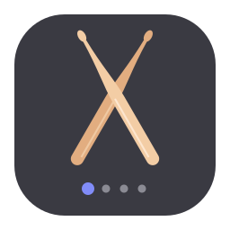
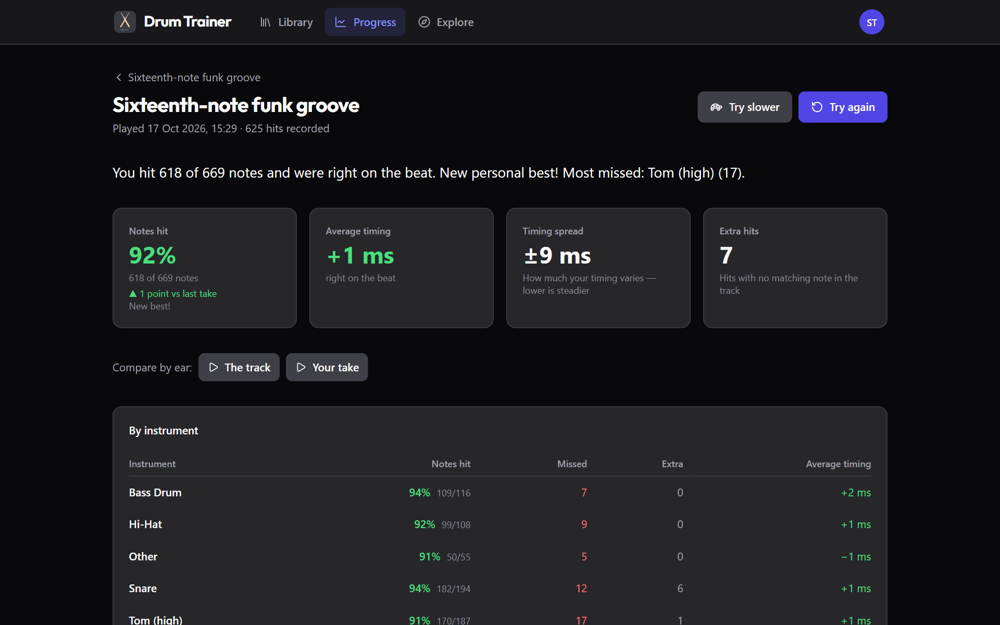
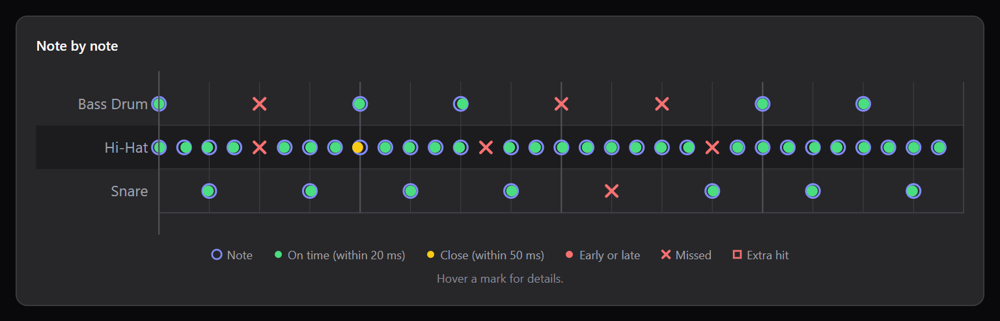
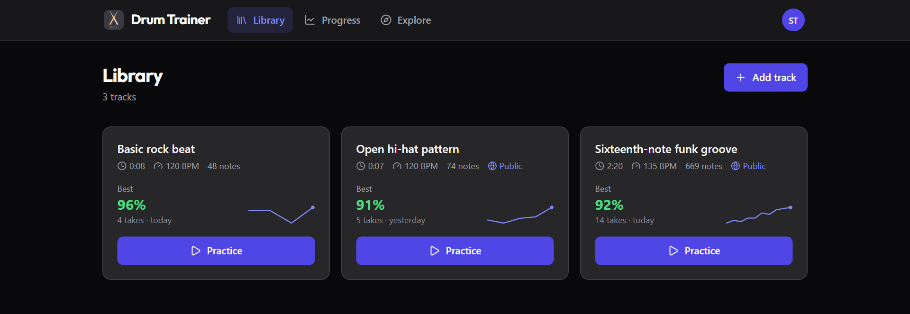
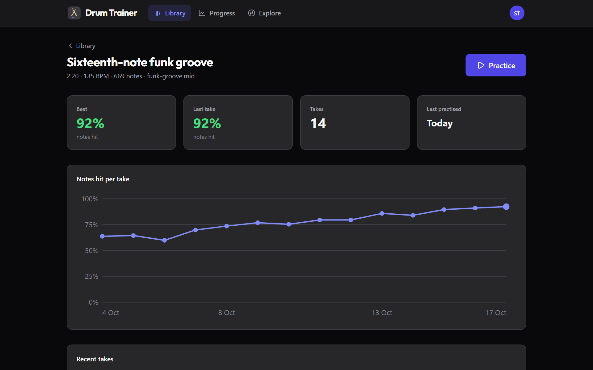
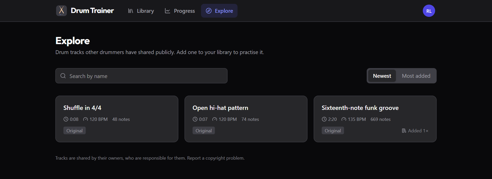

<p align="center">
  
</p>

<h1 align="center">Drum Trainer</h1>

<p align="center">
  <strong>Practise along with any MIDI drum track on your e-drum kit and see exactly how well you played, note by note.</strong>
</p>

<p align="center">
  <a href="https://github.com/schms27/drum.trainer/actions/workflows/docker.yml?query=branch%3Amain"></a>
  <a href="https://github.com/schms27/drum.trainer/releases/latest"></a>
  <a href="LICENSE"></a>
</p>

<p align="center">
  <a href="#features">Features</a> ·
  <a href="#self-hosting-with-docker-compose">Self-hosting</a> ·
  <a href="#local-development">Development</a> ·
  <a href="#releasing-a-new-version">Releases</a>
</p>

<p align="center">
  
</p>

---

Playing along to a song feels great, but it's hard to hear whether that fill was really on time or which hi-hat notes you keep dropping. **Drum Trainer listens to your kit instead.** Load the part you want to learn as a MIDI file, plug in your e-drums over USB and play. Afterwards you see every note you hit, missed or rushed, how steady your timing was and whether you're getting better over time.

It runs in the browser, needs no install for players, and you can host it yourself with a single Docker Compose file.

## How it works

1. **Add a track:** upload a standard MIDI file. The drum part is found automatically.
2. **Connect your kit:** plug your e-drums in over USB, run the pad check once and map your pads to instruments.
3. **Play:** with a count-in, an optional click and your own backing track, at full speed or slowed down.
4. **See how it went:** a score for every take, per instrument and per note, plus your progress across takes.

## Features

### Practise

- **Any MIDI file** as a practice target, with automatic drum-channel detection
- **Adjustable tempo:** slow a track down and the target, scoring and backing audio all scale with it
- **Backing tracks:** add audio (MP3, WAV, OGG, FLAC, AAC, M4A), such as the song without drums, and it plays in sync at any tempo
- **Count-in and click:** start with a one-bar count-in or on your first note, with an optional click during the take and an automatic stop at the end
- **Kit profiles:** map your kit's pads to instruments once by hitting each pad, then use the mapping for every track

### Get feedback

- **Score for every take:** notes hit, average timing (early or late), timing spread and extra hits
- **Per instrument:** see whether it's the snare or the toms that need work
- **Note by note:** a timeline of every target note and what you played, with timing to the millisecond
- **Compare by ear:** listen to the track, then to your take

<p align="center">
  
</p>

### Track your progress

- **Progress per track:** your notes-hit rate across takes, best and last take, how often you've practised
- **History and weekly stats:** every take kept, with a weekly overview of your practice time

<table>
  <tr>
    <td width="50%"></td>
    <td width="50%"></td>
  </tr>
  <tr>
    <td align="center"><sub>Your library at a glance</sub></td>
    <td align="center"><sub>Watch a track come together</sub></td>
  </tr>
</table>

### Share with other drummers

- **Share by link:** send a track to a bandmate or your students. They add their own copy and practise it with their own scores.
- **Explore:** list your grooves and exercises publicly so any drummer can find them, search them and add them to their library
- **Only the drum notes are shared:** the original MIDI file, your backing audio and your practice history stay private
- **Built for responsible sharing:** owners declare where each part comes from, and transcriptions of other people's songs can't be listed publicly. Anyone can report a track, and admins can review reports, remove tracks together with all their copies and block repeat infringers.

<p align="center">
  
</p>

### And also

- Light and dark theme (follows your system, or choose one)
- Sign in with Google or GitHub
- Runs on PostgreSQL or zero-config SQLite; database migrations run automatically on startup

## Browser Requirements

The recording feature requires the [Web MIDI API](https://developer.mozilla.org/en-US/docs/Web/API/Web_MIDI_API), which is currently supported in Chromium-based browsers (Chrome, Edge, Opera). Firefox and Safari do not support Web MIDI.

---

## Self-Hosting with Docker Compose

This is the recommended way to run drum.trainer in production.

### Prerequisites

- Docker and Docker Compose
- A Google or GitHub OAuth application (see below)
- A reverse proxy terminating TLS (nginx, Caddy, Traefik, Pangolin, etc.)

### 1. Create OAuth credentials

**Google**
1. Go to [Google Cloud Console](https://console.cloud.google.com/) → APIs & Services → Credentials
2. Create an OAuth 2.0 Client ID (Web application)
3. Add `https://your-domain.com/api/v1/auth/google/callback` as an authorised redirect URI

**GitHub**
1. Go to GitHub → Settings → Developer settings → OAuth Apps → New OAuth App
2. Set the callback URL to `https://your-domain.com/api/v1/auth/github/callback`

You can configure one or both providers; unused ones can be left blank.

### 2. Create a `.env` file

```env
# Database
POSTGRES_USER=drum
POSTGRES_PASSWORD=a-strong-random-password

# Public URL of the app (no trailing slash)
BASE_URL=https://your-domain.com

# Release to run (see "Releasing a New Version"). Leave unset to track latest.
DRUM_TRAINER_VERSION=1.2.3

# Random secret for signing OAuth CSRF state cookies — generate with:
#   openssl rand -hex 32
SESSION_SECRET=replace-with-a-random-secret

# OAuth — configure at least one provider
GOOGLE_CLIENT_ID=
GOOGLE_CLIENT_SECRET=
GITHUB_CLIENT_ID=
GITHUB_CLIENT_SECRET=

# Set to true only for local HTTP development (disables Secure cookie flag)
DEV_MODE=false

# Moderation of shared tracks: who may review reports, and the address
# published for copyright notices
ADMIN_EMAILS=you@example.com
CONTACT_EMAIL=copyright@example.com

# Host path where persistent data (uploads, postgres) will be stored
CONTAINER_MOUNTS_PATH=/opt/docker-data
```

### 3. Copy `compose.yml` and `nginx.conf`

Both files are provided in the root of this repository:

- [`compose.yml`](compose.yml) — Docker Compose service definitions
- [`nginx.conf`](nginx.conf) — nginx reverse proxy configuration

Copy them to your server and place `nginx.conf` at the path referenced by the `proxy` volume mount in `compose.yml`.

### 4. Start

```bash
docker compose up -d
```

Point your external reverse proxy at port `9980`. The app will be available at the `BASE_URL` you configured.

---

## Environment Variable Reference

### Backend

| Variable | Required | Default | Description |
|---|---|---|---|
| `DATABASE_URL` | No | — | PostgreSQL connection string. If unset, SQLite is used (`DB_PATH`). |
| `DB_PATH` | No | `./data/drum_trainer.db` | SQLite database file path (ignored when `DATABASE_URL` is set). |
| `UPLOAD_DIR` | No | `./data/uploads` | Directory for uploaded MIDI and pilot audio files. |
| `PORT` | No | `8080` | Port the backend listens on. |
| `BASE_URL` | Yes | `http://localhost:8080` | Public base URL. Used to build OAuth callback URLs. |
| `SESSION_SECRET` | Yes | *(insecure default)* | Secret for signing OAuth CSRF state cookies. Use `openssl rand -hex 32`. |
| `GOOGLE_CLIENT_ID` | No | — | Google OAuth client ID. |
| `GOOGLE_CLIENT_SECRET` | No | — | Google OAuth client secret. |
| `GITHUB_CLIENT_ID` | No | — | GitHub OAuth client ID. |
| `GITHUB_CLIENT_SECRET` | No | — | GitHub OAuth client secret. |
| `MAX_UPLOAD_SIZE_MB` | No | `16` | Maximum MIDI file upload size in MB. |
| `MAX_PILOT_SIZE_MB` | No | `150` | Maximum backing track (audio) upload size in MB. |
| `MAX_SESSION_HITS` | No | `20000` | Maximum number of recorded hits accepted per session submission. |
| `DEV_MODE` | No | `false` | Set to `true` for local HTTP development. Disables the `Secure` flag on session cookies. |
| `ADMIN_EMAILS` | No | — | Comma-separated emails of users who can review reports and remove shared tracks at `/admin/reports`. Matched against the email from the OAuth provider. |
| `CONTACT_EMAIL` | Recommended | — | Address for copyright notices, published on `/terms` and `/copyright`. Set it before enabling sharing in production. |

### Frontend

None. The frontend is a static single-page app served by nginx; all configuration lives in the backend.

### Compose

| Variable | Required | Default | Description |
|---|---|---|---|
| `DRUM_TRAINER_VERSION` | No | `latest` | Image tag for both the backend and frontend images, e.g. `1.2.3`. Pin this in production. |

---

## Local Development

### Prerequisites

- Go 1.24.2+
- Node.js 20+
- A Chromium-based browser for MIDI recording

### Setup

```bash
# Backend
cd backend
go run ./main.go

# Frontend (separate terminal)
cd frontend
npm install
npm run dev
```

The backend runs on `http://localhost:8080` and the frontend on `http://localhost:5173`. The Vite dev server proxies `/api/*` to the backend, so no CORS configuration is needed locally.

For OAuth to work locally you will need to set the backend environment variables and set `DEV_MODE=true`. Alternatively, skip login entirely by temporarily disabling the `RequireAuth` middleware during development.

### Running Tests

```bash
# Backend
cd backend
go test ./...

# Frontend
cd frontend
npm test
```

---

## Architecture

| Layer | Technology |
|---|---|
| Frontend | SvelteKit 2 + Svelte 5, Tailwind CSS 4, D3 |
| Backend | Go 1.24, chi router |
| Database | PostgreSQL (production) or SQLite (development) |
| Auth | OAuth 2.0 via Google / GitHub, server-side session cookie |
| MIDI parsing | gitlab.com/gomidi/midi/v2 |
| Scoring | Closest-first matching, per-note window (25–200ms, by note spacing), per instrument group |

Migrations run automatically on startup. Both SQLite and PostgreSQL migration sets are embedded in the binary.

## Releasing a New Version

Releases are one click: **Actions → Release → Run workflow** on `main`, or from a terminal:

```bash
gh workflow run release.yml
```

The [Release workflow](.github/workflows/release.yml):

1. Runs all tests.
2. Picks the next version from the commits since the last release, using [git-cliff](https://git-cliff.org) and [`cliff.toml`](cliff.toml): commits starting with *Add*, *Implement*, *Support*, … bump the minor version, a commit containing *BREAKING* bumps the major version, everything else bumps the patch version. Choose `patch`, `minor` or `major` in the run form to override.
3. Regenerates [`CHANGELOG.md`](CHANGELOG.md), commits it to `main` and tags the commit (e.g. `v1.2.3`).
4. Creates a [GitHub Release](https://github.com/schms27/drum.trainer/releases) with the notes for that version.
5. Builds and pushes versioned images to the GitHub Container Registry (`ghcr.io/schms27/drum-trainer-backend` and `ghcr.io/schms27/drum-trainer-frontend`).

Release notes are built from commit subjects, so a clear first line ("Add count-in before recording", "Fix tom mapping") is all that's needed. Preview what the next release would contain:

```bash
npx git-cliff@2.14.2 --unreleased --bump
```

Each release produces these image tags for both images:

| Tag | Example |
|---|---|
| Exact version | `1.2.3` |
| Major.minor | `1.2` |
| Major | `1` |
| Short SHA | `a3f9c12` |

Every push to `main` also publishes `latest` and a short-SHA tag.

To deploy a release, set `DRUM_TRAINER_VERSION` in your `.env` (or leave it unset to track `latest`) and run:

```bash
docker compose pull
docker compose up -d
```

To roll back, set `DRUM_TRAINER_VERSION` to the previous version and run the same commands. Migrations only move forward, so roll back across a release that added a migration only if you also restore a database backup.

## License

[MIT](LICENSE)
